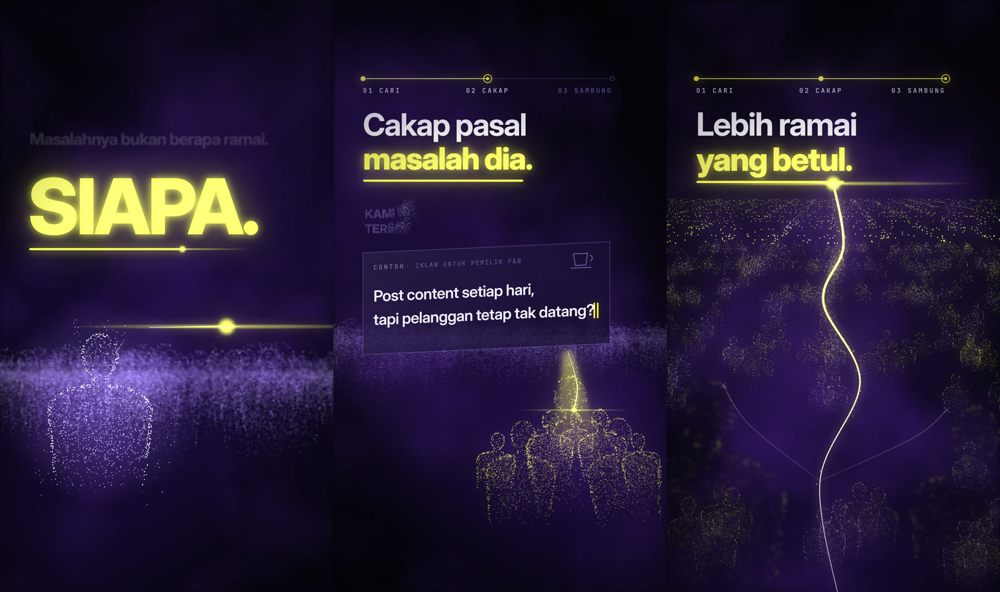

# EP02 · Style Frames (look development)

> **Status:** 🟡 **Menunggu approval kau.** Beat map dan animatic tidak dimulakan sebelum style frames diluluskan.
> Ini imej pegun (stills) sahaja, bukan video atau production. Dirender dengan kod yang sama seperti pipeline EP01 (HTML/Canvas → Playwright).



| Frame | Momen dalam video | Fail (2160×3840) | 1080×1920 | Dengan nota gerak |
|---|---|---|---|---|
| **SF1 · HOOK "SIAPA."** | Scene 01 ≈ 6.2 s | [`EP02_SF1_HOOK_SIAPA.jpg`](EP02_SF1_HOOK_SIAPA.jpg) | [1080](EP02_SF1_HOOK_SIAPA_1080.jpg) | [annotated](EP02_SF1_HOOK_SIAPA_annotated.jpg) |
| **SF2 · CAKAP "masalah dia."** | Scene 04 ≈ 34.5 s | [`EP02_SF2_CAKAP_MASALAH_DIA.jpg`](EP02_SF2_CAKAP_MASALAH_DIA.jpg) | [1080](EP02_SF2_CAKAP_MASALAH_DIA_1080.jpg) | [annotated](EP02_SF2_CAKAP_MASALAH_DIA_annotated.jpg) |
| **SF3 · SAMBUNG "yang betul."** | Scene 05 ≈ 47.5 s | [`EP02_SF3_SAMBUNG_YANG_BETUL.jpg`](EP02_SF3_SAMBUNG_YANG_BETUL.jpg) | [1080](EP02_SF3_SAMBUNG_YANG_BETUL_1080.jpg) | [annotated](EP02_SF3_SAMBUNG_YANG_BETUL_annotated.jpg) |

## Tujuan setiap frame
- **SF1: lautan beku, satu manusia.** Mengunci rupa hook: orang ramai kelabu yang beku, satu siluet manusia yang terbentuk daripada titik cahaya (K1), titik kuning yang mula memanjang jadi Signal Line, dan typography paling besar dalam video (**SIAPA.**) dengan underline yang sedang dilukis.
- **SF2: momen "aha".** Mengunci cara kita tunjuk content strategy tanpa suara: iklan lama yang pecah jadi zarah, kad iklan F&B (`CONTOH`) dengan cursor kuning, pancaran kuning yang sempit, dan kelompok pemilik F&B yang bertukar kuning dan condong ke arah mesej. Signal Rail di y220–290.
- **SF3: payoff / bookend.** Mengunci shot hero: lautan manusia dari atas seperti peta bandar waktu malam, kini kuning. Laluan pemenang (ads) bersinar, dua cabang uji malap dan putus. Signal Line mengalir terus ke underline headline.

## Sistem visual yang dikunci oleh frames ini
| Elemen | Ketetapan |
|---|---|
| Zarah manusia | Siluet kepala + bahu dari titik cahaya; tepi lebih padat; bahagian bawah melebur. Bokeh lensa untuk yang luar fokus. **Tiada garis plexus** |
| Signal Line | Teras putih panas + glow kuning berlapis + flare anamorfik mendatar pada hujung; satu-satunya sumber cahaya bermakna |
| Typography | Inter Display ExtraBold/Bold (−3.5 px tracking) · JetBrains Mono untuk HUD/label · kuning hanya pada kata kunci, underline dilukis |
| Lighting | Ink `#05030A`, kabus ungu volumetrik `#602AC8 → #301270`, bloom pada kuning sahaja, vignette, grain filem |
| Gerak | Ditunjukkan dalam versi *annotated*: masked rise, underline L→R, titik → siluet, huruf pecah jadi zarah, gelombang penyalaan, kamera (dolly / push-in / crane-out) |

## Jana semula
```bash
node LOKADIGITAL/06_VIDEO_PROJECTS/EP02/ASSETS/STYLE_FRAMES/src/render_styleframes.js <outDir>
```
PNG 2160×3840 (±15 MB setiap satu) tidak disimpan dalam Git (`.gitignore`); JPG di folder ini ialah versi semakan. Font: Inter Display (sistem) dan JetBrains Mono (SIL OFL, `src/fonts/`).
