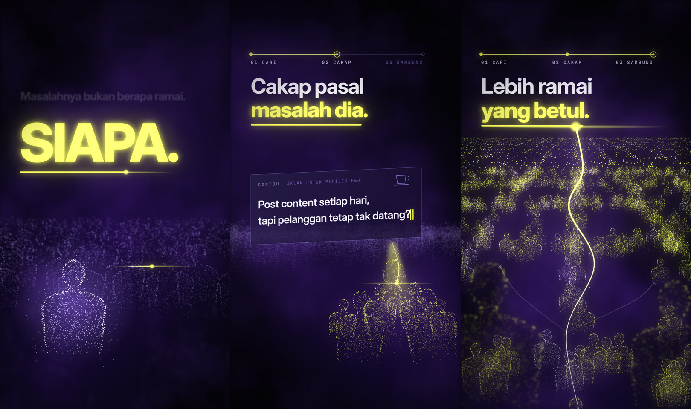

# EP02 · Style Frames (look development)

> **Status:** ✅ **v2 DILULUSKAN (FINAL, D20): visual benchmark rasmi EP02.** Langkah seterusnya: [beat map + animatic](../../PRODUCTION/README.md).
> Ini imej pegun (stills) sahaja, bukan video atau production. Dirender dengan kod yang sama seperti pipeline EP01 (HTML/Canvas → Playwright).



## Versi semasa: v2
| Frame | Momen dalam video | Penuh 2160×3840 | 1080×1920 | Dengan nota gerak |
|---|---|---|---|---|
| **SF1 · HOOK "SIAPA."** | Scene 01 ≈ 6.2 s | [`EP02_SF1_HOOK_SIAPA_v2.jpg`](v2/EP02_SF1_HOOK_SIAPA_v2.jpg) | [1080](v2/EP02_SF1_HOOK_SIAPA_v2_1080.jpg) | [annotated](v2/EP02_SF1_HOOK_SIAPA_v2_annotated.jpg) |
| **SF2 · CAKAP "masalah dia."** | Scene 04 ≈ 34.5 s | [`EP02_SF2_CAKAP_MASALAH_DIA_v2.jpg`](v2/EP02_SF2_CAKAP_MASALAH_DIA_v2.jpg) | [1080](v2/EP02_SF2_CAKAP_MASALAH_DIA_v2_1080.jpg) | [annotated](v2/EP02_SF2_CAKAP_MASALAH_DIA_v2_annotated.jpg) |
| **SF3 · SAMBUNG "yang betul."** | Scene 05 ≈ 47.5 s | [`EP02_SF3_SAMBUNG_YANG_BETUL_v2.jpg`](v2/EP02_SF3_SAMBUNG_YANG_BETUL_v2.jpg) | [1080](v2/EP02_SF3_SAMBUNG_YANG_BETUL_v2_1080.jpg) | [annotated](v2/EP02_SF3_SAMBUNG_YANG_BETUL_v2_annotated.jpg) |

## Sejarah versi
| Versi | Tarikh | Perubahan | Status | Fail |
|---|---|---|---|---|
| v1 | 2026-11-25 | Style frames pertama (commit `5f7caa1`) | Disemak: approve dengan pembetulan | [`v1/`](v1/) |
| **v2** | 2026-11-25 | **SF1:** jalur kabus diganti dengan 5 lapisan kedalaman manusia yang jarang, jadi individu di belakang siluet utama boleh dibaca. Kamera sedikit di atas paras kepala supaya lapisan tersebar menegak. Signal Line dipendekkan (≈110 px) dan diturunkan ke paras kepala siluet, jadi tidak lagi selari dengan underline SIAPA. **SF2:** serpihan "KAMI TER…" dibuang (iklan lama sudah hilang pada 28.9 s). **SF3:** kepadatan dan kecerahan siluet kuning di tengah dan bawah ditingkatkan, dan warna "kuning-putih" dikurangkan; latar kekal gelap untuk kontras. Typography, font, palet, komposisi dan focal point tidak diubah | ✅ Diluluskan (benchmark) | [`v2/`](v2/) |

## Style frames tambahan (Creative Direction v2): SF4 + SF5
> **Status:** 🟡 **v1 menunggu review kau** (D22). Elemen baharu C1–C10 mesti diluluskan rupanya sebelum storyboard v6.

| Frame | Momen | Penuh 2160×3840 | 1080×1920 | Nota gerak |
|---|---|---|---|---|
| **SF4 · CARI "Fail Orang Yang Betul"** | Scene 03 ≈ 17 s | [`EP02_SF4_CARI_FAIL_v1.jpg`](SF4_SF5_v1/EP02_SF4_CARI_FAIL_v1.jpg) | [1080](SF4_SF5_v1/EP02_SF4_CARI_FAIL_v1_1080.jpg) | [annotated](SF4_SF5_v1/EP02_SF4_CARI_FAIL_v1_annotated.jpg) |
| **SF5 · SAMBUNG "Amplifier"** | Scene 05 ≈ 42 s | [`EP02_SF5_SAMBUNG_AMPLIFIER_v1.jpg`](SF4_SF5_v1/EP02_SF5_SAMBUNG_AMPLIFIER_v1.jpg) | [1080](SF4_SF5_v1/EP02_SF5_SAMBUNG_AMPLIFIER_v1_1080.jpg) | [annotated](SF4_SF5_v1/EP02_SF5_SAMBUNG_AMPLIFIER_v1_annotated.jpg) |

- **SF4** mengunci rupa **watak utama** (sanggul, apron, telefon di tangan, muka diterangi cahaya telefon), **lensa** (alat CARI), dan **Fail Orang Yang Betul**. Tiga masalah C4 dalam fail, setiap satu dengan visual sendiri: 01 tujuh post harian → kedai dengan meja kosong · 02 mata → titik pandangan gugur sebelum sampai ke beg kosong · 03 meter bajet susut + barisan pelanggan rata. Frame menunjukkan modul 03 sedang ditulis.
- **SF5** mengunci **3 variasi iklan** dengan meter "berhenti scroll", **amplifier** (ads) sebagai objek 3D, **pancaran** yang hanya menyalakan orang yang sepadan profil, dan **watak utama** di latar depan, kini mendongak dan kuning.

## Tujuan setiap frame
- **SF1: lautan beku, satu manusia.** Mengunci rupa hook: orang ramai kelabu yang beku, satu siluet manusia yang terbentuk daripada titik cahaya (K1), titik kuning yang mula memanjang jadi Signal Line, dan typography paling besar dalam video (**SIAPA.**) dengan underline yang sedang dilukis.
- **SF2: momen "aha".** Mengunci cara kita tunjuk content strategy tanpa suara: iklan lama yang pecah jadi zarah, kad iklan F&B (`CONTOH`) dengan cursor kuning, pancaran kuning yang sempit, dan kelompok pemilik F&B yang bertukar kuning dan condong ke arah mesej. Signal Rail di y220–290.
- **SF3: payoff / bookend.** Mengunci shot hero: lautan manusia dari atas seperti peta bandar waktu malam, kini kuning. Laluan pemenang (ads) bersinar, dua cabang uji malap dan putus. Signal Line mengalir terus ke underline headline.

## Sistem visual yang dikunci oleh frames ini
| Elemen | Ketetapan |
|---|---|
| Zarah manusia | Siluet kepala + bahu dari titik cahaya; tepi lebih padat; bahagian bawah melebur. Bokeh lensa untuk yang luar fokus. **Tiada garis plexus** |
| Signal Line | Teras putih panas + glow kuning berlapis + flare anamorfik mendatar pada hujung; satu-satunya sumber cahaya bermakna |
| Typography | Inter Display ExtraBold/Bold (−3.5 px tracking) · JetBrains Mono untuk HUD/label · kuning hanya pada kata kunci, underline dilukis |
| Lighting | Ink `#05030A`, kabus ungu volumetrik `#602AC8 → #301270`, bloom pada kuning sahaja, vignette, grain filem |
| Gerak | Ditunjukkan dalam versi *annotated*: masked rise, underline L→R, titik → siluet, huruf pecah jadi zarah, gelombang penyalaan, kamera (dolly / push-in / crane-out) |

## Jana semula
```bash
node LOKADIGITAL/06_VIDEO_PROJECTS/EP02/ASSETS/STYLE_FRAMES/src/render_styleframes.js <outDir>
```
PNG 2160×3840 (±15 MB setiap satu) tidak disimpan dalam Git (`.gitignore`); JPG dalam `v1/` dan `v2/` ialah versi semakan. Kod sumber semasa menghasilkan v2; v1 boleh dijana semula dari commit `5f7caa1`. Font: Inter Display (sistem) dan JetBrains Mono (SIL OFL, `src/fonts/`).
