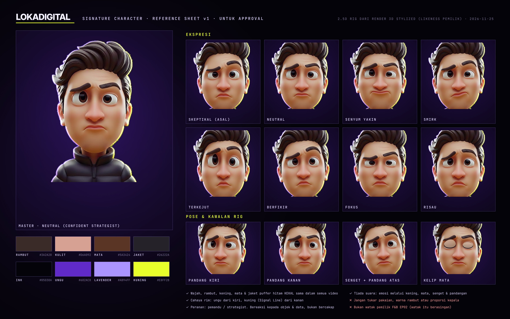

# LOKADIGITAL — Signature Character (v1, untuk approval)

> **Status:** 🟡 **Menunggu approval kau.** Digunakan dalam Sample 01 sebagai **production test sahaja**, bukan production akhir.
> Likeness: render 3D stylized wajah pemilik (diberikan 2026-11-25, dengan persetujuan untuk digunakan sebagai karakter rasmi LokaDigital).
> Berasingan daripada watak pemilik F&B EP02.

## 1. Analisis wajah sumber
| Ciri | Pemerhatian | Peraturan konsistensi |
|---|---|---|
| Gaya | Render 3D stylized premium (gaya filem animasi), kepala besar, dagu lembut | Kekalkan proporsi kepala ±1.0 lebar bahu |
| Rambut | Pompadour coklat gelap, bervolum, belahan ke kanan | Tidak berubah dalam mana-mana video |
| Kening | Tebal, gelap; kiri menurun, kanan terangkat (skeptikal) | Kening = alat ekspresi utama |
| Mata | Besar, iris coklat, putih mata jelas | Pandangan mengikut objek (mata = penunjuk cerita) |
| Mulut | Bibir penuh, ekspresi asal mencebik | Ekspresi asal = "skeptikal"; tiada mulut terbuka (lihat had) |
| Pakaian | Jaket puffer hitam berkolar tinggi | Pakaian tetap (identiti) |
| Warna | Rambut `#3A2A28`, kulit `#D6A092`, mata `#5A3424`, jaket `#26222A` | Ditambah cahaya rim jenama: ungu kiri, kuning (Signal Line) kanan |

## 2. Personaliti
Confident, intelligent, approachable, creative strategist. Dia **tidak bercakap** (tiada VO). Dia bereaksi, berfikir, menilai dan "melukis" penyelesaian bersama Signal Line.

## 3. Aset
| Fail | Keterangan |
|---|---|
| [`assets/LD_character_master_1024.png`](assets/LD_character_master_1024.png) | Master RGBA 1024 px (latar dibuang, tanda air ✦ dibuang, dipertajam) |
| [`rig/landmarks.json`](rig/landmarks.json) | 22 titik kawalan muka (kening, kelopak, iris, mulut, pipi, hidung, dagu, muka, rambut) |
| [`rig/ld_character.js`](rig/ld_character.js) | Rig 2.5D (three.js): 8 ekspresi boleh dicampur, pandangan mata, kelip, toleh, senget, nafas, rim light |
| [`expressions/`](expressions/) | 8 ekspresi + 4 pose (PNG lutsinar 1024) |
| [`reference_sheet/LD_SIGNATURE_CHARACTER_REFERENCE_SHEET_v1.jpg`](reference_sheet/LD_SIGNATURE_CHARACTER_REFERENCE_SHEET_v1.jpg) | Reference sheet 3840×2400 |

**Ekspresi:** skeptikal (asal), neutral, senyum yakin, smirk, terkejut, berfikir, fokus, risau.
**Kawalan:** `eyeX/eyeY` (pandangan), `blink`, `yaw` (toleh), `tilt` (senget), `breathe`, `rimY/rimP` (cahaya rim).

## 4. Had teknikal (jujur)
- **Bukan rig 3D penuh.** Sumber hanya satu gambar 512×512 sudut depan. Rig ini mengubah bentuk gambar itu (2.5D), jadi watak **tidak boleh berpusing melebihi ~15°**, tiada pandangan sisi/belakang, dan tiada badan penuh atau tangan.
- **Mulut tidak boleh dibuka** (tiada lukisan gigi/lidah). Ekspresi senyum ialah senyum tertutup.
- **Resolusi asal 512 px** dinaikkan ke 1024 px, jadi watak tajam pada saiz kepala sehingga ~1000 px dalam frame 1080×1920. Lebih besar akan kelihatan lembut.
- Persekitaran production ini tiada GPU dan tiada Blender.

**Untuk tahap production penuh (cadangan):** model 3D sebenar (Blender/Maya) berdasarkan likeness ini, dengan rig muka (blendshapes) dan badan, dihasilkan oleh 3D artist atau alat generatif 3D. Kemudian ia dirender dengan GPU. Rig 2.5D ini boleh kekal untuk content pantas (reaksi kepala dan bahu).
