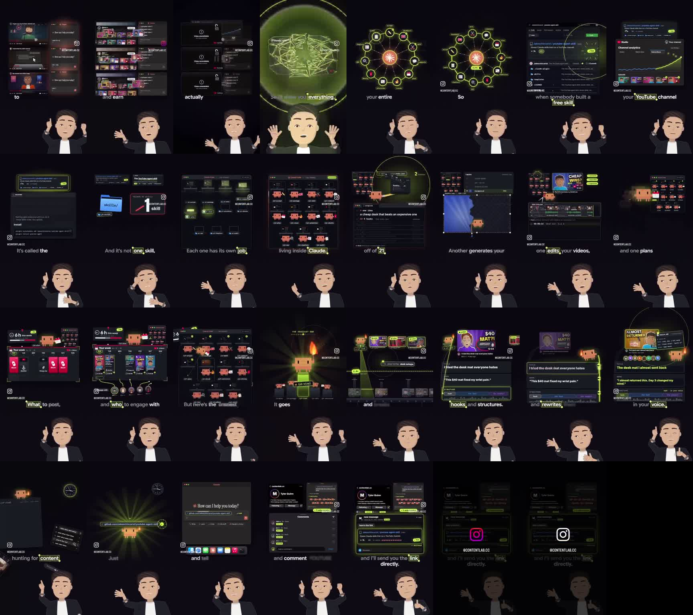

# REF-002 — Avatar Explainer Reel (gaya editing untuk LokaDigital)

> Dianalisis: 2026-11-25 · Sumber: fail video yang kau upload (`WhatsApp_Video_2026-11-25_at_11.58.15_PM.mp4`, akaun @CONTENTLAB.CC dalam video)
> Link IG (`DgFKz76yf7L`, `Dfgklgzj5fw`) **tidak dapat dibuka**: Instagram disekat dalam environment ni. Analisis ini hanya berdasarkan fail yang di-upload.
> Tujuan: simpanan **gaya editing** untuk LokaDigital. Semua warna diterjemah ke palette LokaDigital. Teknik dipinjam, isi dan rupa tidak disalin.

## 1. Data teknikal
| | |
|---|---|
| Format | 9:16, 61.6 s (fail WhatsApp 576×1024, asal mungkin 1080×1920), 30 fps |
| Audio | VO Bahasa Inggeris + muzik bawah. **−14.0 LUFS**, LRA 1.6 LU (sangat padat, konsisten) |
| Kelajuan VO | 228 perkataan / 57 s = **~241 patah perkataan seminit** (sangat laju) |
| Potongan | Pengesanan scene tidak menjumpai *hard cut*. Peralihan dibuat dengan gerakan kamera, zoom dan morph di atas satu kanvas gelap (inferens daripada frame, bukan disahkan frame demi frame) |

## 2. Struktur cerita (ikut masa)
| Masa | Fungsi | Isi |
|---|---|---|
| 0.0–4.1 | **Hook: claim besar** | "Everyone is using Claude to automate their YouTube…" |
| 4.3–5.9 | **Tension** | "But nobody is actually showing you how." |
| 6.1–10.6 | **Janji** | "So I'll show you everything." (kanvas pecah, avatar ke tengah) |
| 11.0–18.1 | **Asal-usul** | "somebody built a free skill…" + nama benda |
| 18.3–19.8 | **Reveal** | "It's not one skill, it's 11." |
| 20.0–36.6 | **Senarai** | Satu demi satu, setiap satu dengan visual bukti sendiri |
| 36.7–47.0 | **Eskalasi** | "But here's the craziest one…" (spotlight + api) |
| 47.1–49.6 | **Payoff** | "No more scrolling for hours…" |
| 49.8–53.9 | **Halangan dibuang** | "The setup is super easy." |
| 54.1–56.7 | **CTA kata kunci** | "Follow and comment YOUTUBE…" |
| 57–61.6 | **End card** | Logo IG + handle, fade ke gelap |

Pola: **Claim → Tension → Promise → Reveal number → List → "Craziest one" → Payoff → Easy → CTA.**

## 3. Sistem visual (kenapa ia berkesan)
1. **Layout 3 tingkat yang tetap**
   - **Atas (~55%): pentas bukti.** Skrin UI, dashboard, fail, kod. Inilah "bukti" kepada apa yang dikatakan.
   - **Tengah: jalur caption.** Caption perkataan demi perkataan. Kata kunci dibingkai kotak bergaris warna aksen dengan titik di sudut.
   - **Bawah (~35%): avatar hos.** Kartun 3D, dipotong separas dada, gestur berubah setiap beat (tunjuk ke atas, tapak tangan terbuka, berfikir).
   Mata penonton tahu di mana nak lihat, jadi maklumat padat pun masih mudah diikut.
2. **Avatar sebagai sauh.** Hos tanpa muka sebenar memberi rasa "ada orang bercakap dengan aku" tanpa perlu merakam.
3. **Satu warna aksen sahaja** di atas latar hampir hitam: glow, kotak kata kunci, cincin spotlight dan garis fokus semua guna satu warna.
4. **Cincin spotlight / kanta pembesar** mengarahkan mata ke satu butiran dalam skrin yang sibuk.
5. **Kanvas tanpa potongan.** Kamera bergerak, zoom dan pan dari satu skrin ke skrin lain, jadi video terasa satu aliran berterusan.
6. **Angka sebagai hook kecil:** 11, 21, 10x, 6h. Setiap angka memberi otak sesuatu untuk dipegang.
7. **Maskot berulang** (watak piksel oren). ⚠️ Watak ni nampak seperti Clawd, watak milik Anthropic. **Jangan guna.**
8. **Audio:** VO padat dan konsisten pada −14 LUFS, muzik rendah di bawah, sound effect kecil pada setiap pop-up.

## 4. Kelemahan / perkara yang TIDAK sesuai untuk LokaDigital
- **Claim tak boleh dibuktikan** ("earn thousands of dollars", "10 times faster"). Ini bercanggah dengan keputusan kau: tiada angka atau claim rekaan.
- **Nada hype** ("craziest one"). LokaDigital diposisikan tenang dan analitikal.
- **VO 241 patah perkataan seminit** terlalu laju untuk Bahasa Melayu premium, dan **bercanggah dengan peraturan tiada VO** (lihat §6).
- Avatar gaya Memoji agak generik. Tool asal yang menghasilkannya tidak diketahui.

## 5. Terjemahan ke LokaDigital (warna dan gaya)
| Dalam reference | Versi LokaDigital |
|---|---|
| Latar hitam | Ink black `#05030A` dengan cahaya ungu `#602AC8 → #301270` yang bergerak perlahan |
| Aksen hijau limau | **Electric yellow `#E8FF2B`**, hanya untuk makna (insight, pemenang, sistem, brand) |
| Kotak kata kunci hijau | Kotak kata kunci kuning, nipis, dengan titik sudut. Satu kata kunci sahaja setiap baris |
| Cincin spotlight | **Signal Line** menjadi cincin atau garis fokus yang menunjuk ke butiran penting |
| Teks sokongan putih | Mist `#D4CAF2`. Label meta guna grey `#7C7396`, ALL CAPS, tracking luas |
| UI pelbagai warna | UI dilukis semula dalam palette ungu, lavender `#AB94FF` dan kuning |
| Muzik + SFX | Muzik dan SFX dijana sendiri, setiap pop-up ada bunyi, −14 LUFS |
| CTA "comment YOUTUBE" | **DM LOKADIGITAL** |
| Angka hype | Hanya angka yang boleh dibuktikan, atau dilabel **CONTOH** |

## 6. Keputusan yang diperlukan daripada kau
Reference ni bergantung pada **avatar bercakap + VO**. Peraturan LokaDigital sekarang: **tiada VO untuk semua video** (keputusan muktamad). Pilihan:
- **A. Kekal tanpa VO.** Guna layout 3 tingkat, kanvas tanpa potongan, kotak kata kunci dan spotlight. Avatar diganti dengan watak siluet (pemilik F&B dari EP02) yang bergestur tanpa bercakap. Caption menjadi teks atas skrin dengan masa bacaan yang cukup.
- **B. Format baru dengan VO dan avatar** (contohnya untuk siri "tips" berasingan). Kau perlu ubah peraturan tiada VO untuk format tu, dan tentukan suara siapa (rakaman sendiri adalah percuma dan paling natural).

## 7. Teknik yang boleh dibuat dalam Hyperframes (percuma)
- Caption perkataan demi perkataan dengan kata kunci berkotak (masa diambil dari Whisper jika ada VO, atau dari beat map jika tiada)
- Skrin UI dilukis dengan HTML/CSS, kamera kanvas (pan, zoom, punch-in), cincin spotlight, glow
- Watak kartun 2D yang dilukis dengan kod, dengan gestur asas. Avatar 3D gaya Memoji **tidak** boleh dihasilkan dengan kualiti yang sama tanpa tool luar.
